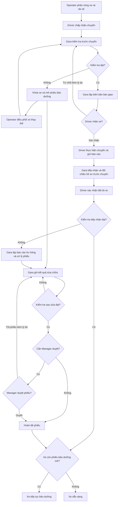
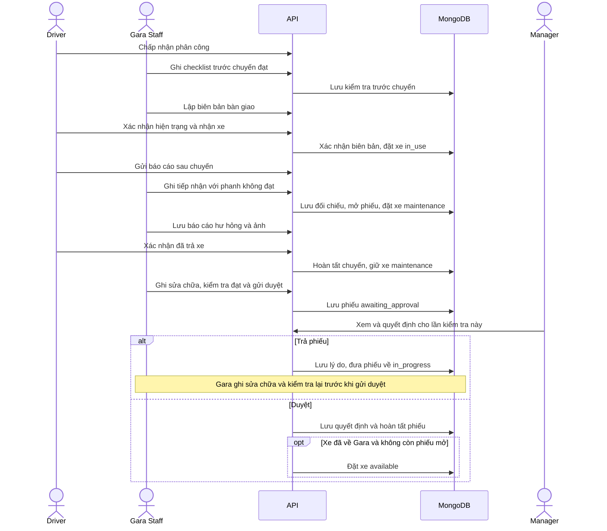

# Quy trình Gara – Người 3

## Use Case Specification

| Mã | Actor | Điều kiện và thao tác | Kết quả và ngoại lệ |
| --- | --- | --- | --- |
| UC-G01 | Gara Staff | Mở `/garage/tasks` để xem nhiệm vụ từ phân công, chuyến chờ trả xe và phiếu bảo dưỡng đang mở. | Chỉ mở checklist trước chuyến khi Driver đã nhận phân công. |
| UC-G02 | Gara Staff | Kiểm tra ngoại thất, nội thất, lốp, đèn, phanh, nhiên liệu, giấy tờ và thiết bị an toàn. Nhập số km, phần trăm nhiên liệu, ghi chú và 1–3 ảnh JPG/PNG. | Cả tám mục đạt thì được lập biên bản. Có mục không đạt thì xe chuyển sang bảo dưỡng và Operator đổi xe. |
| UC-G03 | Gara Staff, Driver | Gara lập biên bản từ kết quả đạt. Driver xem hồ sơ và xác nhận đúng xe trong vòng 24 giờ trước giờ đón. | Xe chuyển sang `in_use`. Driver có thể từ chối kèm lý do để Gara kiểm tra lại. Xe thay thế giữa chuyến có thể được nhận ngoài khung giờ bàn giao ban đầu. |
| UC-G04 | Gara Staff, Driver | Sau khi Driver gửi báo cáo sau chuyến, Gara ghi nhận tiếp nhận, nhập số km và đối chiếu hồ sơ trước chuyến. Driver xác nhận đã trả xe. | Chuyến hoàn tất sau xác nhận. Xe đạt có thể về `available`. Xe không đạt giữ trạng thái `maintenance` và có phiếu bảo dưỡng. |
| UC-G05 | Gara Staff, Operator | Từ hồ sơ tiếp nhận không đạt, ghi hạng mục hỏng, mô tả, dùng ảnh lúc tiếp nhận hoặc tải ảnh mới. Có thể chọn **Chuyển Operator xử lý**. | Lưu báo cáo kèm bằng chứng. Nếu chuyển xử lý, Operator thấy sự cố trong trang Điều phối. Việc đóng sự cố giữ nguyên trạng thái của chuyến đã hoàn tất. |
| UC-G06 | Gara Staff | Mở phiếu, ghi công việc, kết quả sửa và kiểm tra lại trên cùng phiếu. | Kiểm tra không đạt thì giữ phiếu mở. Khi đạt, Gara hoàn tất phiếu thường hoặc gửi Manager duyệt nếu ảnh hưởng an toàn. |
| UC-G07 | Manager | Xem phiếu ở `/manager/maintenance-approvals`. Duyệt kết quả hoặc trả phiếu kèm lý do. | Quyết định được lưu với người duyệt, thời điểm và mã lần kiểm tra. Phiếu trả về cần ghi sửa chữa và kiểm tra mới. Xe chỉ sẵn sàng khi đã về Gara và hết phiếu đang mở. |

Phanh, lốp, đèn, thiết bị an toàn và báo hỏng giữa chuyến yêu cầu Manager duyệt. Gara có thể đánh dấu thêm **Ảnh hưởng an toàn** khi ghi sửa chữa. Operator chỉ có thể phân công lại xe sau khi xe đáp ứng điều kiện bảo dưỡng, lịch và sức chứa.

## Activity Diagram



## Sequence Diagram



## Dữ liệu trong MongoDB Compass

Kết nối tới cùng URI mà backend dùng trong `MONGO_URI`. Các bước kiểm tra và bàn giao của Gara dùng MongoDB replica set để ghi hồ sơ cùng trạng thái xe trong transaction. Nếu máy chưa có replica set, script `npm.cmd --prefix BE run db:local` tạo instance local khi cổng 27017 còn trống.

| Collection | Trường dùng để đối chiếu |
| --- | --- |
| `trip_workflows` | `booking_id`, `vehicle_id`, `handover_inspection_id`, `return_inspection_id`, `vehicle_returned_at` |
| `vehicle_inspections` | `inspection_id`, `vehicle_id`, `inspection_type`, `inspected_at`, `before_inspection_id`, `maintenance_id`, `checklist`, `odometer`, `fuel_percent`, `photo_count` |
| `vehicle_handovers` | `inspection_id`, `driver_id`, `status`, `prepared_at`, `responded_at`, `refusal_reason` |
| `vehicle_damages` | `inspection_id`, `damaged_items`, `evidence_source`, `incident_id`, `maintenance_id` |
| `maintenance_records` | `maintenance_id`, `vehicle_id`, `maintenance_status`, `repair_work`, `repair_result`, `repair_completed_at`, `reinspection_id`, `approvals` |
| `vehicles` | `vehicle_id`, `plate_number`, `status` |

Tìm chuyến theo `booking_id`, rồi dùng `vehicle_id` để xem trạng thái xe. Từ lần kiểm tra tiếp nhận không đạt, dùng `inspection_id` để tìm báo cáo hư hỏng và `maintenance_id` để tìm phiếu sửa chữa.

## Kịch bản demo

Dùng bốn phiên trình duyệt độc lập hoặc đổi tài khoản khi tới vai trò tiếp theo. Xem [tài khoản demo](../../../../README.md#5-đăng-nhập-tài-khoản-demo). Chuẩn bị booking **Một chiều** đã xác nhận, còn trong vòng 24 giờ trước giờ đón, với xe và tài xế đủ điều kiện, cùng một ảnh JPG hoặc PNG.

1. **Operator** vào `/operator/dispatch` để phân công. **Driver** vào `/driver/dashboard#driver-workflow` và chọn **Chấp nhận chuyến**.
2. **Gara** vào `/garage/tasks`, mở checklist, đánh dấu cả tám mục đạt, nhập số km `1400`, nhiên liệu `65` và ảnh. Lưu kiểm tra rồi chọn **Lập biên bản bàn giao**.
3. **Driver** làm mới mục **Phân công và cập nhật hành trình**, mở biên bản và chọn **Xác nhận hiện trạng và nhận xe**. Chọn **Đã đón khách**, **Hoàn thành lượt đi**, rồi **Xác nhận trả khách & gửi báo cáo** với số km cuối `1500`.
4. **Gara** mở nhiệm vụ **Tiếp nhận xe**, nhập `1505` km, chọn **Phanh – Không đạt**, đánh dấu đạt cho các mục còn lại và tải ảnh. Lưu tiếp nhận rồi **Lập báo cáo hư hỏng**. **Driver** làm mới và **Xác nhận trả xe cho Gara**. Trong Compass, booking phải hoàn tất còn xe ở `maintenance`.
5. **Gara** mở phiếu bảo dưỡng, ghi công việc và kết quả, kiểm tra lại đạt rồi **Gửi Manager duyệt**. **Manager** vào `/manager/maintenance-approvals`, chọn **Trả phiếu về Gara** và ghi lý do.
6. **Gara** làm mới phiếu, ghi sửa chữa và kiểm tra lại, rồi gửi lại. **Manager** chọn **Duyệt hoàn tất bảo dưỡng**. Làm mới hồ sơ Gara và Compass. Nếu đây là phiếu mở cuối cùng, xe chuyển về `available`.

Nếu danh sách Manager đang trống, thực hiện đến bước gửi duyệt để có hồ sơ chờ xử lý. Ở danh sách Gara, chọn **Đặt lại bộ lọc** nếu nhiệm vụ nằm ngoài ngày đang chọn.

## Kiểm thử tự động

Chạy từ thư mục gốc. Đổi cổng hoặc tên replica set trong `TEST_MONGO_URI` cho khớp máy đang chạy.

```powershell
$env:TEST_MONGO_URI = 'mongodb://127.0.0.1:27018/?replicaSet=rentalLocal'
node --test BE/tests/garage-pre-trip-inspection.test.js
npm.cmd --prefix FE run build
```

Test tạo database riêng và xóa sau khi chạy. Các ca bao gồm Driver từ chối nhận xe, đổi xe giữa chuyến, trả xe đạt và không đạt, bằng chứng hư hỏng, Manager trả/duyệt phiếu, quyết định trùng, phân quyền và chặn điều phối khi xe còn bảo dưỡng.
