# XeDi database schema

Nguồn schema: các Mongoose model trong `BE/src/models/` và khai báo index trong `BE/src/database/indexes.js`. Đây là schema ứng dụng hiện tại, không phải bản dump dữ liệu của một MongoDB đang chạy.

## Quy ước

- MongoDB lưu document trong collection; các model kế thừa `_id` kiểu `ObjectId`, trừ `renter_contact_keys` dùng `_id` dạng chuỗi.
- Quan hệ trong sơ đồ là tham chiếu logic từ trường `*_id` và Mongoose `ref`. MongoDB không cưỡng chế khóa ngoại; service kiểm tra tính hợp lệ và quyền truy cập.
- Các đối tượng con như `identity_kyc`, `terms_snapshot`, `condition_report`, `items` và lịch sử được nhúng trong document cha, không phải collection riêng.
- `Mixed` được dùng có chủ đích cho snapshot/payload thay đổi theo chính sách; các trường còn lại được định kiểu trong model.

## ERD logic

```mermaid
erDiagram
  ROLES ||--o{ USERS : "primary_role_id"
  USERS }o--o{ ROLES : "additional_role_ids"
  USERS ||--o{ VEHICLES : "owner_id"
  VEHICLES ||--o{ VEHICLE_INSPECTIONS : "vehicle_id"
  USERS ||--o{ VEHICLE_INSPECTIONS : "garage_staff_id / manager_id"
  VEHICLES ||--o{ MANAGEMENT_AGREEMENTS : "vehicle_id"
  USERS ||--o{ MANAGEMENT_AGREEMENTS : "owner_id / signer_id"
  VEHICLES ||--o{ VEHICLE_INTAKES : "vehicle_id"
  MANAGEMENT_AGREEMENTS ||--o{ VEHICLE_INTAKES : "management_agreement_id"
  USERS ||--o{ VEHICLE_INTAKES : "garage staff"
  VEHICLES ||--o{ VEHICLE_LISTINGS : "vehicle_id"
  USERS ||--o{ VEHICLE_LISTINGS : "operation staff"
  USERS ||--o{ BOOKINGS : "renter_id"
  VEHICLES ||--o{ BOOKINGS : "vehicle_id"
  VEHICLE_LISTINGS o|--o{ BOOKINGS : "listing_id"
  MANAGEMENT_AGREEMENTS o|--o{ BOOKINGS : "management_agreement_id"
  BOOKINGS ||--o| RENTAL_AGREEMENTS : "booking_id, unique"
  MANAGEMENT_AGREEMENTS o|--o{ RENTAL_AGREEMENTS : "management_agreement_id"
  BOOKINGS ||--o{ RENTAL_HANDOVERS : "booking_id + handover_type unique"
  VEHICLES ||--o{ RENTAL_HANDOVERS : "vehicle_id"
  USERS o|--o{ RENTAL_HANDOVERS : "garage_staff_id"
  BOOKINGS o|--o{ PAYMENT_TRANSACTIONS : "booking_id"
  USERS o|--o{ PAYMENT_TRANSACTIONS : "initiator_user_id"
  PAYMENT_TRANSACTIONS o|--o{ PAYMENT_TRANSACTIONS : "related_transaction_id"
  BOOKINGS ||--o| SECURITY_DEPOSITS : "booking_id, unique"
  PAYMENT_TRANSACTIONS o|--o{ SECURITY_DEPOSITS : "collection / movement"
  INCIDENT_CASES o|--o{ SECURITY_DEPOSITS : "deduction_decisions / movements"
  USERS ||--o{ OWNER_SETTLEMENTS : "owner_id"
  VEHICLES o|--o{ OWNER_SETTLEMENTS : "vehicle_id"
  MANAGEMENT_AGREEMENTS o|--o{ OWNER_SETTLEMENTS : "management_agreement_id"
  BOOKINGS o|--o{ OWNER_SETTLEMENTS : "items.booking_id"
  PAYMENT_TRANSACTIONS o|--o{ OWNER_SETTLEMENTS : "payout_transaction_id"
  VEHICLES ||--o{ INCIDENT_CASES : "vehicle_id"
  BOOKINGS o|--o{ INCIDENT_CASES : "booking_id"
  USERS o|--o{ INCIDENT_CASES : "reporter / assignee / reviewer"
  RENTAL_HANDOVERS o|--o{ INCIDENT_CASES : "source_handover_id"
  VEHICLES ||--o{ VEHICLE_WITHDRAWAL_REQUESTS : "vehicle_id"
  USERS ||--o{ VEHICLE_WITHDRAWAL_REQUESTS : "owner_id / operation staff"
  MANAGEMENT_AGREEMENTS o|--o{ VEHICLE_WITHDRAWAL_REQUESTS : "management_agreement_id"
  BOOKINGS o|--o{ VEHICLE_WITHDRAWAL_REQUESTS : "affected_bookings.booking_id"
  USERS o|--o{ PLATFORM_POLICIES : "updated_by_manager_id"
  USERS ||--o{ NOTIFICATIONS : "recipient_user_id"
  USERS o|--o{ AUDIT_LOGS : "actor_user_id"
  USERS o|--o{ SYSTEM_REPORTS : "generated_by"
  USERS ||--o{ RENTER_FILES : "owner_id"
  RENTER_FILES ||--o{ RENTER_FILE_CHUNKS : "file_id"

  ROLES { ObjectId _id PK }
  USERS { ObjectId _id PK ObjectId primary_role_id FK ObjectId[] additional_role_ids FK }
  VEHICLES { ObjectId _id PK ObjectId owner_id FK }
  VEHICLE_INSPECTIONS { ObjectId _id PK ObjectId vehicle_id FK ObjectId garage_staff_id FK }
  MANAGEMENT_AGREEMENTS { ObjectId _id PK ObjectId vehicle_id FK ObjectId owner_id FK }
  VEHICLE_INTAKES { ObjectId _id PK ObjectId vehicle_id FK ObjectId management_agreement_id FK }
  VEHICLE_LISTINGS { ObjectId _id PK ObjectId vehicle_id FK }
  BOOKINGS { ObjectId _id PK ObjectId renter_id FK ObjectId vehicle_id FK }
  RENTAL_AGREEMENTS { ObjectId _id PK ObjectId booking_id FK }
  RENTAL_HANDOVERS { ObjectId _id PK ObjectId booking_id FK ObjectId vehicle_id FK }
  PAYMENT_TRANSACTIONS { ObjectId _id PK ObjectId booking_id FK String idempotency_key UK }
  SECURITY_DEPOSITS { ObjectId _id PK ObjectId booking_id FK }
  OWNER_SETTLEMENTS { ObjectId _id PK ObjectId owner_id FK }
  INCIDENT_CASES { ObjectId _id PK String case_number UK ObjectId vehicle_id FK }
  VEHICLE_WITHDRAWAL_REQUESTS { ObjectId _id PK ObjectId vehicle_id FK ObjectId owner_id FK }
  PLATFORM_POLICIES { ObjectId _id PK String policy_type Number version }
  NOTIFICATIONS { ObjectId _id PK ObjectId recipient_user_id FK }
  AUDIT_LOGS { ObjectId _id PK ObjectId actor_user_id FK }
  SYSTEM_REPORTS { ObjectId _id PK String report_type }
  RENTER_CHALLENGES { ObjectId _id PK Date expires_at }
  RENTER_FILES { ObjectId _id PK ObjectId owner_id FK }
  RENTER_FILE_CHUNKS { ObjectId _id PK ObjectId file_id FK Number n }
  RENTER_CONTACT_KEYS { String _id PK }
  DISCOUNT_CODES { ObjectId _id PK String code UK }
```

`o|` biểu thị tham chiếu tùy chọn. Quan hệ có `unique` được ghi chú trong nhãn; các quan hệ khác không nhất thiết bị giới hạn một-một ở tầng database.

## Collection và trường chính

| Collection | Trường chính / embedded data |
|---|---|
| `roles` | `code`, `display_name`, `permissions[]`, `description`, timestamps |
| `users` | `full_name`, `email`, `phone`, `department`, `job_title`, `work_scope`, `password_hash`, `primary_role_id`, `additional_role_ids[]`, `account_status`; embedded `identity_kyc`, `driver_license`, `verification_history[]`, `contact_profile`, `payout_profile`; timestamps |
| `vehicles` | `owner_id`, `license_plate`, `vin`, brand/model/year/seats/fuel/transmission/type, `daily_price`, `mileage_policy`, `photos[]`, `physical_status`, `onboarding_status`, embedded `documents`, `registration_history[]`, workflow versions, manager review, timestamps |
| `vehicle_inspections` | `vehicle_id`, `garage_staff_id`, `reviewed_by_manager_id`, `inspection_type`, `inspected_at`, embedded `condition_report`, `recommendation`, `approval_status`, decision/schedule fields, `version`, timestamps |
| `management_agreements` | `vehicle_id`, `owner_id`, platform signer, `agreement_number`, dates, `commission_rate_pct`, embedded `authorization_scope`, `signature_info`, `contract_document`, amendments, manager review, status/termination, timestamps |
| `vehicle_intakes` | `vehicle_id`, `management_agreement_id`, garage staff, received/owner-confirmed times, odometer/fuel, embedded `condition_snapshot`, document key, status, version, timestamps |
| `vehicle_listings` | `vehicle_id`, operation staff IDs, title/description/photos, `pickup_location`, price/deposit, mileage/rental policy snapshots, `availability_blocks[]`, status and timestamps |
| `bookings` | `booking_code`, `renter_id`, `vehicle_id`, optional listing/agreement, start/end and actual times, pickup/return location, rental/deposit amounts, pricing/policy snapshots, review/cancellation info, status/history, hold/payment deadlines, discount fields and workflow version |
| `rental_agreements` | `booking_id`, optional management agreement, `contract_number`, lender/renter snapshots, terms snapshot, signing info, contract document, amendments, manager review, status and signing/timestamps |
| `rental_handovers` | `booking_id`, `vehicle_id`, garage staff, `handover_type` (`pickup`/`return`), time, odometer/fuel, embedded vehicle condition/photos/signature, surcharges, status/version/timestamps |
| `payment_transactions` | optional booking/initiator, transaction type/direction, amount/currency/method/provider, provider transaction ID, related transaction, required `idempotency_key`, status/provider response, paid/created times |
| `security_deposits` | `booking_id`, collection payment, required/collected/deducted/refunded/refundable amounts, `movements[]`, `deduction_decisions[]`, status, refund due date, updated time |
| `owner_settlements` | `owner_id`, optional vehicle/agreement, period, `items[]` (booking revenue and commission), gross/commission/adjustments/net payout, payout transaction/status, settlement/creation time |
| `incident_cases` | `case_number`, reporter/operation/manager IDs, `vehicle_id`, optional booking, case/incident type, location/odometer/severity, handover/request keys, description/evidence, investigation, traffic-violation details, compensation claims, resolution, operation timeline, status/timestamps |
| `vehicle_withdrawal_requests` | `vehicle_id`, `owner_id`, optional agreement/assignee, request type/reason/times, `affected_bookings[]`, termination notice, final settlement, owner return handover, status/completed/created times |
| `platform_policies` | `policy_type`, `version`, `config`, effective dates, updating manager, status, created time |
| `notifications` | `recipient_user_id`, type/title/content, generic related entity, delivery channels, read state and timestamps |
| `audit_logs` | actor, action, entity type/id, sanitized changes, masked IP, created time |
| `system_reports` | report type (`finance`/`operations`), title, period, report data, generator and generated time |
| `renter_challenges` | actor, purpose, target, code hash, attempts/used, created/expiry times |
| `renter_files` | owner, purpose, content type, size, filename, created time |
| `renter_file_chunks` | file reference, chunk number `n`, binary `data` |
| `renter_contact_keys` | string `_id` used as the unique contact key |
| `discount_codes` | code, active state, start/expiry, minimum order, usage counters/limit, discount type/value |

## Important indexes

- Unique identifiers: role `code`, user `email`, vehicle `license_plate`, management agreement `agreement_number`, intake `management_agreement_id`, booking `booking_code`, rental agreement `contract_number` and `booking_id`, payment `idempotency_key`, security deposit `booking_id`, incident `case_number`, discount `code`.
- Rental handover: unique compound `(booking_id, handover_type)` to prevent duplicate pickup/return records.
- Booking lookup: `(renter_id, created_at)` and `(vehicle_id, status, start_at, end_at)`.
- Inspection queue: `(garage_staff_id, approval_status, created_at)` plus one open onboarding inspection per vehicle through a partial unique index.
- Renter file lookup: `(owner_id, created_at)`; chunks `(file_id, n)`; renter challenges expire through a TTL index on `expires_at`.
- Other workflow indexes are declared alongside the `collections` list in `BE/src/database/indexes.js`.

## Schema source files

All model definitions are registered in `BE/src/models/index.js`. Collection/index setup is in `BE/src/database/indexes.js`; nested contract document fields are defined in `BE/src/models/contract-document.js`.
