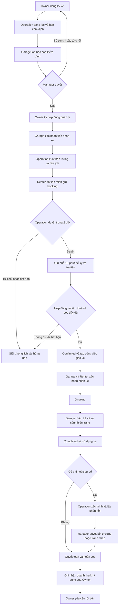

# Luồng nghiệp vụ chính thức của Xedi

Phiên bản 1.0 — Ngày 10 tháng 11 năm 2026

Tài liệu này chốt baseline nghiệp vụ để nhóm thống nhất SRS, màn hình, API, dữ liệu và kiểm thử. Xedi là nền tảng thuê xe tự lái từ chủ xe cá nhân, trong đó chủ xe ủy quyền cho nền tảng quản lý xe và gara thực hiện kiểm định, tiếp nhận, giao và nhận trả xe. Nền tảng điều phối booking; chủ xe không duyệt từng chuyến thuê.

Baseline bao phủ toàn bộ UC01–UC41 trong SRS và các nghiệp vụ được mô tả thêm nhưng chưa có mã thống nhất. Các quyết định giải quyết mâu thuẫn và quy tắc bổ sung được ghi riêng ở mục 2; đây là đặc tả đích, không phải tuyên bố mọi chức năng đã được triển khai. Tệp SRS gốc và mã nguồn không bị thay đổi bởi tài liệu này.

## 1 Phạm vi và vai trò

Phiên bản đầu vận hành nhận và trả tại cùng gara, thuê theo ngày, tối thiểu 24 giờ. Giao xe tận nơi, trả khác gara, thuê có tài xế, đổi xe giữa chuyến và định vị GPS liên tục là phần mở rộng; không hiển thị như chức năng đang khả dụng. GPS trong báo cáo sự cố là vị trí được người dùng chia sẻ, không mặc nhiên là thiết bị theo dõi trên xe.

| Vai trò | Trách nhiệm chính | Giới hạn |
| --- | --- | --- |
| Guest | Tìm xe, xem chi tiết, đăng ký và đăng nhập | Không tạo booking hoặc xem dữ liệu cá nhân |
| Renter | Xác minh danh tính và GPLX, đặt xe, ký hợp đồng, trả tiền, nhận/trả xe, phản hồi phí, khiếu nại và đánh giá | Chỉ dữ liệu của mình; không tự xác nhận đã nhận tiền hoặc tự chuyển trạng thái chuyến |
| Car Owner | Xác minh danh tính, đăng ký xe, ký ủy quyền quản lý, xem lịch và thu nhập, yêu cầu rút tiền/rút xe, báo phạt nguội | Chỉ xe và thu nhập của mình; không duyệt booking, tự xuất bản xe hoặc tự khấu trừ cọc |
| Garage Staff | Công việc được phân công, kiểm định, nhập gara, giao thuê, nhận trả, báo hư hỏng và giao trả chủ xe | Ghi nhận thực tế; không duyệt xe cuối cùng hoặc quyết định bồi thường |
| Operation Staff | Sàng lọc hồ sơ, lịch hẹn và phân công, listing/lịch xe, duyệt booking, hỗ trợ chuyến, điều tra sự cố, lập quyết toán | Đề xuất quyết định; không tự duyệt khoản bồi thường đang tranh chấp |
| Manager | Duyệt xe, phê duyệt bồi thường/tranh chấp và ngoại lệ, chính sách, hợp đồng quản lý, nhân sự nghiệp vụ, báo cáo | Không sửa ngược hợp đồng đã ký hoặc giả lập giao dịch tiền thành công |
| Admin | Tài khoản, quyền hệ thống, audit, cấu hình tích hợp và thông báo, kiểm duyệt đánh giá | Vai trò Admin không tự động thay thế thẩm quyền nghiệp vụ Manager |

Một tài khoản có thể có cả Renter và Car Owner. Không cho người dùng thuê chính xe mình sở hữu. Owner chỉ cần xác minh danh tính để đăng ký xe; GPLX chỉ bắt buộc khi chính người đó thuê/lái. Nhân sự được cấp tài khoản nội bộ, không tự đăng ký vai trò đặc quyền. Manager quản lý Garage/Operation trong phạm vi được giao; chỉ Admin được cấp quyền Admin hoặc Manager. Chưa tách vai trò Accountant trong baseline.

## 2 Quyết định giải quyết mâu thuẫn của SRS

| Vấn đề | Quyết định baseline | Căn cứ và thay đổi |
| --- | --- | --- |
| Tiêu đề có Driver Management nhưng nghiệp vụ là tự lái | Thống nhất tên hệ thống quản lý thuê xe tự lái và xe ủy quyền | Không thêm luồng thuê tài xế chỉ từ tiêu đề mẫu |
| SRS vừa gọi P2P vừa có gara giữ xe | P2P về nguồn xe, nền tảng quản lý tập trung về vận hành | Phù hợp chuỗi UC14–UC21 và dữ liệu hiện có |
| Đạt kiểm định tự Available | Manager duyệt → ký hợp đồng quản lý → nhập gara → Operation xuất bản | Đạt kiểm định không đồng nghĩa đã nhận xe hoặc được phép bán lịch |
| Giữ chỗ 15 phút nhưng duyệt trong 2 giờ | `pending` chờ duyệt tối đa 2 giờ; chỉ sau duyệt mới bắt đầu 15 phút ký/thanh toán | Quyết định bổ sung; tách hai đồng hồ, không bắt khách trả tiền trong lúc chờ staff |
| Duyệt booking chuyển Confirmed trước thanh toán | Duyệt chỉ chuyển `awaiting_payment`; đủ hợp đồng, tiền thuê và cọc mới `confirmed` | Tránh giao xe khi chưa đủ điều kiện |
| SRS dùng 10%, seed dùng 15% hoa hồng | Mặc định hợp đồng quản lý mới là 10% theo SRS; hợp đồng đã ký giữ mức đã ký | Cần sửa cấu hình/seed khi triển khai, không tự sửa hợp đồng cũ |
| Tìm kiếm tối thiểu 1 giờ nhưng đặt tối thiểu 24 giờ | Cả tìm kiếm báo giá và tạo booking áp dụng tối thiểu 24 giờ | Tránh tìm được khoảng thuê mà không thể đặt |
| Khởi hành sau 2 giờ nhưng chờ duyệt 2 giờ | Thời gian nhận phải còn tối thiểu 2 giờ tại lúc gửi và lúc duyệt | Quyết định bổ sung; nếu duyệt quá sát giờ phải chọn lịch mới, không tự dịch lịch |
| Hủy trước 24/48 giờ không thống nhất | Miễn phí nếu còn ít nhất 48 giờ; dưới 48 giờ thu tối đa một ngày tiền thuê, không vượt tiền thuê thực trả | Mốc 48 giờ theo seed; mức phí một ngày là quy tắc bổ sung của baseline |
| Quá hạn chuyển cấp sau 4/6 giờ | Cảnh báo ngay khi quá hạn; sau 4 giờ mà không liên hệ được thì chuyển Manager | Theo phần Operation của SRS; thay seed 6 giờ khi triển khai |
| Garage hoàn tất trả xe có nghĩa gì | `completed` nghĩa là hoàn thành sử dụng xe; quyết toán, hoàn cọc, phạt nguội theo trạng thái riêng | Phù hợp luồng trả xe hiện có, không đồng nhất Completed với đã hoàn tiền |
| Operation tự quyết bồi thường | Operation điều tra/đề xuất; Manager phê duyệt bồi thường và khoản đang tranh chấp | Áp dụng cho mọi giá trị, không chỉ tranh chấp lớn |
| Pre-authorization và thu cọc lẫn nhau | Baseline ghi nhận thu cọc và hoàn cọc riêng; phong tỏa thẻ chỉ dùng khi tích hợp thực sự hỗ trợ | Không giả định mọi cổng thanh toán hỗ trợ escrow/hold |
| Sửa hợp đồng đã ký | Tạo phụ lục/phiên bản mới và lấy chấp thuận liên quan | Không ghi đè nội dung hoặc giá trị tài chính của bản đã ký |

Các hằng số trên là chính sách sản phẩm để triển khai và demo, không phải kết luận pháp lý. Hạng GPLX, quy tắc giấy tờ và hiệu lực ký điện tử phải là cấu hình/tích hợp được xác minh trước vận hành thực tế; không sao chép cứng danh sách cũ trong mẫu.

## 3 Luồng xuyên suốt

## 4 Các luồng chi tiết

### F01 Tài khoản và hồ sơ cá nhân

Guest nhập thông tin → hệ thống kiểm tra trùng email/số điện thoại → gửi OTP → xác minh → kích hoạt tài khoản → đăng nhập → vào khu vực theo quyền. Người dùng có thể đăng xuất, quên mật khẩu, đổi mật khẩu và cập nhật hồ sơ. Đổi email/số điện thoại chỉ có hiệu lực sau xác minh kênh mới; đổi mật khẩu nhạy cảm phải xác thực và thu hồi phiên cần thiết.

OTP sai, hết hạn, gửi quá nhiều hoặc tài khoản bị khóa đều phải có nhánh xử lý rõ. Áp dụng giới hạn đăng nhập sai 5 lần/15 phút theo SRS, không khóa vĩnh viễn chỉ vì nhập sai. Khóa tài khoản không xóa nghĩa vụ của chuyến đang chạy; Operation vẫn có thể xử lý trả xe và hoàn tiền. Danh sách chuyến rỗng phải xem được, không yêu cầu từng có booking mới được vào màn hình.

### F02 Xác minh danh tính và điều kiện lái

Renter nộp giấy tờ tùy thân và GPLX → kiểm tra định dạng/chất lượng → xác minh tự động nếu tích hợp sẵn → chuyển Operation xử lý khi chưa xác định được → trả kết quả và lý do → cho sửa và nộp lại. Owner đi cùng quy trình danh tính nhưng không buộc có GPLX nếu chỉ cho thuê xe.

Trạng thái: `unverified → pending → verified / rejected`; giấy tờ hết hạn chuyển `expired`. Kiểm tra lại điều kiện GPLX tại tạo booking, duyệt và bàn giao: đúng người, phù hợp loại xe, còn hiệu lực đến hết chuyến. Thay giấy tờ đã duyệt phải tạo phiên bản chờ xác minh, không tự coi bản mới là hợp lệ. Nhà cung cấp lỗi không được tự duyệt; cho phép kiểm tra thủ công có lưu người duyệt và bằng chứng. Không tự động hủy chuyến đang chạy khi giấy tờ bị đổi; tạo cảnh báo cho Operation.

### F03 Đăng ký xe và sàng lọc hồ sơ

Owner đã xác minh → tạo bản nháp xe → nhập thông số, biển số, ảnh, giá đề xuất và giấy tờ đăng ký/đăng kiểm/bảo hiểm → gửi hồ sơ → Operation đối chiếu chủ sở hữu, tính đầy đủ và thời hạn → yêu cầu bổ sung hoặc hẹn kiểm định và phân công Garage. Hồ sơ giấy tờ xe chỉ được duyệt sau khi đủ ba tệp private, kiểm định đạt và người duyệt ghi audit; yêu cầu bổ sung/từ chối luôn trả lý do cho Owner.

Biển số trùng bị chặn; hồ sơ thiếu/không đọc được phải nộp lại. Xe bị từ chối có lý do và lịch sử, không bị xóa. Đổi thông tin định danh hoặc giấy tờ quan trọng sau duyệt phải qua duyệt lại; xe không đủ điều kiện bị ngừng nhận booking mới và Operation xử lý các booking đã tồn tại.

### F04 Kiểm định và duyệt xe

Garage mở công việc được giao → đối chiếu xe thực tế → ghi checklist kỹ thuật, ODO, nhiên liệu/pin, ảnh và lỗi → lưu nháp → gửi báo cáo cùng đề xuất. Manager xem hồ sơ và báo cáo → phê duyệt, yêu cầu bổ sung/kiểm định lại hoặc từ chối, luôn kèm lý do cho quyết định bất lợi.

Checklist và ảnh là thành phần của cùng báo cáo, không phải hai nghiệp vụ phê duyệt riêng. Garage không tự phê duyệt xe. Kiểm định là đánh giá xe; chưa phải xác nhận nền tảng nhận giữ xe. Báo cáo đã gửi/duyệt không sửa âm thầm; bổ sung bằng phiên bản có lịch sử. Phát hiện hư hỏng không liên quan booking được lập case theo xe/công việc, không buộc gán một renter.

### F05 Hợp đồng quản lý và nhập gara

Sau khi xe được duyệt, Operation chuẩn bị hợp đồng theo mẫu/chính sách đã được Manager cho phép → Owner xem hoa hồng, giá, trách nhiệm và điều kiện rút xe → xác nhận bằng OTP → hệ thống lưu nội dung phiên bản, dấu thời gian và bằng chứng chấp thuận → hẹn tiếp nhận.

Garage kiểm tra phê duyệt và hợp đồng còn hiệu lực → đối chiếu người giao/xe → ghi ODO, nhiên liệu/pin, ảnh, chìa khóa, giấy tờ và phụ kiện → Owner/người được ủy quyền xác nhận → Garage hoàn tất tiếp nhận → custody chuyển `at_garage`. Thiếu hợp đồng, sai xe, thiếu bằng chứng hoặc khác biệt đáng kể thì chưa xác nhận nhập; Operation xử lý trước. Từ chối ký giữ xe ở trạng thái chưa đủ điều kiện đưa lên sàn.

### F06 Listing và lịch khả dụng

Operation tạo listing cho xe đã được duyệt, có hợp đồng quản lý hiệu lực và đã nhập gara → kiểm tra giá, cọc, ảnh, địa điểm, phí và lịch → xuất bản. Xe chỉ đặt được nếu giấy tờ phù hợp thời gian thuê, không bảo trì, không có chặn rút xe và không trùng khoảng đang bị giữ/đã đặt.

Owner gửi cập nhật giá/mô tả/ảnh trong phạm vi được phép → Operation kiểm tra và xuất bản phiên bản mới. Thay đổi không tác động báo giá/hợp đồng đã chốt. Operation có thể chặn lịch bảo dưỡng hoặc tạm dừng listing nhưng không âm thầm xóa booking đã xác nhận; booking bị ảnh hưởng phải được liên hệ, bố trí hoặc hủy có hoàn tiền. Xe đang thuê vẫn có thể xuất hiện cho ngày tương lai nếu lịch đủ điều kiện.

### F07 Tìm xe và báo giá

Guest/Renter chọn gara, thời gian → hệ thống kiểm tra nhận sau ít nhất 2 giờ, thuê ít nhất 24 giờ → lọc hãng, giá, số chỗ, hộp số, nhiên liệu → xem chi tiết, chính sách, đánh giá và báo giá tách dòng.

Số ngày tính tiền = `ceil((end_at - start_at) / 24 giờ)`. Tổng thuê = số ngày × đơn giá đã chốt + phí dịch vụ được công bố − giảm giá hợp lệ. Cọc hiển thị riêng, không cộng vào doanh thu thuê. Mỗi báo giá ghi tiền tệ VND, thời gian, phiên bản giá/chính sách và thời hạn hiệu lực. FE không tự quyết định số tiền cuối cùng.

Mã giảm giá được kiểm tra thời hạn, mức tối thiểu, phạm vi xe, giới hạn mỗi khách và tổng lượt. Baseline dùng tối đa một mã/booking; giữ lượt trong khi chờ, ghi nhận sử dụng khi confirmed, trả lượt nếu rejected/expired. Sau hủy confirmed không tự hoàn lượt. Phần giảm giá do nền tảng tài trợ trong baseline, ghi chi phí riêng; thay đổi bên chịu phải thể hiện trong hợp đồng/chương trình.

Tìm kiếm không giữ chỗ. Khi tạo booking phải kiểm tra lại trong giao dịch chống trùng. Không có kết quả thì cho thay bộ lọc/thời gian, không hiển thị xe không đủ điều kiện để lấp danh sách.

### F08 Gửi và duyệt booking

Renter đã đủ điều kiện → chọn xe/lịch → xem báo giá và chấp thuận chính sách → gửi. Hệ thống kiểm tra lại lịch, quyền và giấy tờ, chốt snapshot, tạo `pending` và giữ khoảng thuê tối đa 2 giờ. Mỗi renter tối đa một booking chưa xác nhận trong baseline để hạn chế chiếm lịch.

Operation kiểm tra hồ sơ, lịch, điểm nhận/trả và khả năng phục vụ → duyệt hoặc từ chối có lý do. Duyệt phải còn ít nhất 2 giờ trước nhận xe; chuyển `awaiting_payment`, tạo hạn 15 phút mới và gửi thông báo. Không cần Owner duyệt từng booking. Từ chối chuyển `rejected`; quá hạn duyệt chuyển `expired`; cả hai giải phóng lịch. Nếu cần lịch mới, renter xác nhận báo giá/booking mới thay vì staff tự thay giờ.

Khoảng giữ lịch là `[start_at, end_at + turnaround_buffer)`. Baseline bổ sung buffer 2 giờ để kiểm tra/vệ sinh giữa hai chuyến; lưu cấu hình theo gara. Kiểm tra cả các khoảng bị chặn và thời gian thực tế xe chưa trả. Hai yêu cầu đồng thời chỉ một yêu cầu được giữ cùng khoảng. Cron dọn giữ chỗ chỉ là hỗ trợ: API luôn bỏ hiệu lực các hold đã hết hạn ngay khi xét lịch.

### F09 Ký hợp đồng thuê và thanh toán

Trong 15 phút sau duyệt: renter đọc hợp đồng chứa snapshot của booking → xác nhận OTP → lưu phiên bản đã ký → sang trang thanh toán của nhà cung cấp → trả tiền thuê và cọc. Ứng dụng không tự lưu PAN/CVV. OTP ký hợp đồng có hiệu lực 180 giây theo SRS, không kéo dài hạn giữ chỗ.

Backend kiểm tra kết quả xác thực từ nhà cung cấp và đối soát mã đơn, số tiền, tiền tệ → ghi giao dịch → chỉ chuyển `confirmed` khi đủ hợp đồng, tiền thuê và cọc, booking còn đủ điều kiện và giữ lịch thành công → tạo công việc giao xe. Trang redirect thành công không đủ để đánh dấu đã trả tiền.

Thanh toán lỗi cho phép thử lại trong thời hạn. Chỉ thu được một phần thì chưa confirmed; hết hạn phải mở hoàn phần đã thu. Callback đến muộn sau expired/cancelled không làm sống lại booking; ghi nhận tiền thực thu và hoàn/đối soát, đặc biệt khi lịch đã bán cho người khác. Callback lặp không thu/ghi nhận hai lần. Nếu kết quả chưa rõ, hiển thị đang đối soát và tra cứu nhà cung cấp trước khi tạo lần trả mới. Hợp đồng chưa đủ điều kiện kích hoạt được đánh dấu hết hiệu lực theo booking, giữ lịch sử ký.

### F10 Hủy booking và không đến nhận

Renter hủy pending/awaiting_payment → kết thúc yêu cầu, giải phóng lịch và hoàn khoản đã thu nếu có. Hủy confirmed trước bàn giao → hiển thị tiền hoàn và phí → renter xác nhận → `cancelled` → giải phóng lịch → tạo yêu cầu hoàn tiền riêng.

Baseline: còn ít nhất 48 giờ thì hoàn toàn bộ tiền thuê; dưới 48 giờ thì phí hủy bằng `min(đơn giá một ngày, tiền thuê thực trả)`. Cọc hoàn toàn bộ khi chưa bàn giao và không có nghĩa vụ hợp lệ khác. Phí dịch vụ và phần không hoàn lại, nếu có, phải được công bố trong snapshot; không tự thêm phí xử lý khi khách bấm hủy. Nền tảng/xe không thể phục vụ thì hoàn toàn bộ khoản đã thu cho dịch vụ chưa cung cấp. Ngoại lệ cần Manager duyệt, lưu lý do.

Quá giờ nhận 60 phút mà renter chưa đến: Operation liên hệ, ghi nhận và quyết định no-show; không tự coi xe đã giao. No-show là lý do `cancelled`, áp dụng phí hủy sát giờ. Đã ongoing không dùng Cancel Booking; xử lý trả sớm/chấm dứt chuyến có biên bản. Hoàn thất bại vẫn giữ booking cancelled, giao dịch refund chờ xử lý và cho khách theo dõi.

### F11 Giao xe cho renter

Garage mở công việc → kiểm tra booking confirmed, hợp đồng, tiền thuê/cọc, xe có mặt và an toàn → đối chiếu danh tính/GPLX người nhận → chụp ảnh, ghi ODO, nhiên liệu/pin, chìa khóa, phụ kiện và giờ thực tế → renter xem và xác nhận → Garage hoàn tất → booking `ongoing`, xe `rented`.

Không chuyển ongoing chỉ vì đến giờ nhận. Sai giấy tờ, thiếu tiền hoặc lỗi xe thì dừng giao, tạo ghi nhận cho Operation; không tự hủy ngay hoặc trừ cọc. Renter không đồng ý hiện trạng thì sửa biên bản nháp hoặc mở xử lý. Chưa có xác nhận người nhận thì không ghi như đã đồng ý. Bấm xác nhận lặp phải trả cùng kết quả, không tạo hai biên bản.

### F12 Chuyến đang chạy và gia hạn

Renter xem chuyến, chính sách, hỗ trợ và báo sự cố. Gia hạn là luồng bổ sung cần có để giải quyết yêu cầu trả muộn chủ động: gửi giờ trả mới trước hạn → Operation kiểm tra lịch/buffer, giấy tờ, hợp đồng quản lý, bảo trì/rút xe → tính phần tiền tăng → renter chấp thuận phụ lục và thanh toán → mới cập nhật end_at.

Trong lúc chờ, giờ trả cũ còn hiệu lực. Gia hạn xung đột, không trả tiền hoặc bị từ chối thì giữ lịch cũ; không tự đẩy booking kế tiếp. Phần thời gian mở rộng phải được giữ chống trùng trong khi xử lý. Nếu không triển khai gia hạn ở giao diện đầu tiên, Operation vẫn phải có nghiệp vụ này; không sửa end_at trực tiếp ngoài quy trình.

### F13 Quá hạn và xe không liên hệ được

Đến giờ trả mà chưa có sự kiện nhận xe thực tế → hệ thống gắn cờ overdue và thông báo Operation/Renter → Operation liên hệ, ghi thời điểm và phản hồi → đưa ra hướng trả xe hoặc điều tra sự cố. Quá 4 giờ không liên hệ được chuyển Manager và báo Owner; nghi mất xe là incident ưu tiên cao, không tự kết luận trách nhiệm hay tự trừ toàn bộ cọc.

Baseline có 30 phút ân hạn; số giờ tính phí = `ceil(max(0, actual_return_at - end_at - 30 phút) / 1 giờ)`, nhân mức phí trong snapshot. Dùng thời điểm xe thực sự được tiếp nhận, không dùng thời điểm staff nhập xong. Xe đã trả nhưng biên bản chưa hoàn thành không tiếp tục tính chậm trả. Phí tạm tính không được ghi nhận lặp mỗi lần job chạy.

### F14 Nhận trả xe và phí phát sinh

Garage ghi nhận xe về và thời gian thực tế → mở biên bản giao ban đầu → kiểm tra/chụp ảnh hiện trạng trả, ODO, nhiên liệu/pin, phụ kiện → hệ thống so sánh và tính phí theo snapshot → renter xem và xác nhận hoặc nêu bất đồng → Garage hoàn tất ghi nhận trả.

Booking chuyển `completed` về sử dụng xe. Xe bình thường trở về `at_garage`, chỉ mở lịch sau kiểm tra/buffer; có lỗi an toàn hoặc hư hỏng mới thì `maintenance` và lập incident. ODO không nhỏ hơn lúc giao; sai số liệu phải được sửa có bằng chứng, không ép tăng để vượt kiểm tra.

Phí vượt km = `max(0, km thực chạy - số ngày đã thanh toán × km miễn phí/ngày) × phí/km`. Phí nhiên liệu/pin, phụ kiện thiếu và vệ sinh bất thường chỉ tính khi có quy tắc trong hợp đồng và chứng cứ. Trả sớm không tự hoàn phần ngày chưa dùng; Operation xử lý yêu cầu, Manager duyệt ngoại lệ.

Nếu renter không đồng ý ký, vẫn ghi nhận đã lấy lại xe và thời gian thực tế với nhân chứng/bằng chứng theo quy trình; trạng thái xác nhận là từ chối/đang tranh chấp, không giả chữ ký. Trả xe xong không có nghĩa mọi khoản phí đã được chấp thuận.

### F15 Sự cố và bảo trì

Renter báo trong chuyến hoặc Garage/Owner báo khi phát hiện → tạo case gắn xe và booking nếu có → phân công Operation → thu thập ảnh trước/sau, mô tả, vị trí khi khả dụng và chi phí dự kiến → xác minh → đề xuất trách nhiệm/chi phí → gửi các bên phản hồi → trình Manager nếu có bồi thường hoặc tranh chấp.

Không buộc có booking cho hư hỏng phát sinh trong thời gian gara giữ xe. Không mặc định renter chịu mọi hư hỏng; phải phân biệt hư hỏng cũ, hao mòn, lỗi kỹ thuật và tổn thất phát sinh. Báo khẩn được lưu ban đầu dù chưa đủ ảnh/GPS; bổ sung chứng cứ trước quyết định tiền. Các báo cáo cùng sự việc được liên kết để tránh khấu trừ hai lần.

Operation tạo lịch sửa chữa và chặn lịch → Garage ghi kết quả sửa/kiểm tra an toàn → Operation mở lại lịch khi đủ điều kiện. Đóng tranh chấp tài chính không tự chuyển xe sang sẵn sàng; sửa xong xe cũng không tự đóng nghĩa vụ bồi thường. Booking tương lai bị ảnh hưởng phải có phương án thông báo và giải quyết.

### F16 Khiếu nại và bồi thường

Renter/Owner mở khiếu nại từ booking, quyết toán hoặc case → Operation tiếp nhận và thu thập hai phía → đề xuất → Manager duyệt/từ chối/yêu cầu bổ sung → thông báo quyết định và căn cứ → thực thi giao dịch đã duyệt → đóng hồ sơ khi hoàn tất hoặc ghi rõ nghĩa vụ còn treo.

Baseline bổ sung cửa sổ phản hồi 48 giờ từ khi thông báo đề xuất phí được cung cấp trong tài khoản; im lặng không được ghi là đồng ý. Khoản tranh chấp chưa kết luận không chuyển cho Owner. Manager không được khấu trừ chỉ từ số tiền Owner yêu cầu, phải có căn cứ và giới hạn trách nhiệm theo hợp đồng. Quyết định mới thay quyết định cũ bằng lịch sử điều chỉnh, không ghi đè chứng cứ.

### F17 Quyết toán chuyến và hoàn cọc

Sau nhận trả, Operation lập bảng quyết toán: tiền thuê đã thu, điều chỉnh, phí thông thường có căn cứ, bồi thường/phạt đã được duyệt, tiền còn thiếu và cọc được hoàn → renter xem/phản hồi → hệ thống thực thi phần không tranh chấp và phần đã có quyết định → đối soát kết quả nhà cung cấp → cập nhật sổ giao dịch.

Cọc còn được hoàn = cọc thực thu − khấu trừ hợp lệ đã thực hiện − phần đã hoàn. Khấu trừ không vượt số cọc còn lại; phần vượt tạo khoản phải thu riêng. Khoản phí phải thu và giao dịch khấu trừ là hai bản ghi phân biệt, không giảm cọc hai lần khi chạy lại quyết toán. Không tính hoa hồng trên tiền cọc hoặc tiền bồi thường trong baseline.

Phần cọc không tranh chấp được lập lịch hoàn trong 3 ngày làm việc sau khi có biên bản trả và đủ thông tin đối soát. Nếu có tranh chấp chỉ giữ phần có căn cứ, thông báo số tiền/lý do/mốc cập nhật; phần còn lại vẫn hoàn. Sau quyết định cuối cùng, hoàn phần dư trong 3 ngày làm việc. Không giữ toàn bộ cọc vô thời hạn để chờ phạt nguội có thể xuất hiện. Ngày làm việc dùng lịch cấu hình của hệ thống.

Refund có trạng thái `pending → processing → succeeded / failed`; lỗi/timeout cần retry có khóa chống lặp và tra cứu trước khi gửi lại. Chỉ thông báo đã hoàn tiền khi có xác nhận tương ứng. Với tích hợp phong tỏa thẻ sau này, release/capture phải theo đúng khả năng và thời hạn nhà cung cấp, không giả định hold còn hiệu lực mãi.

### F18 Phạt nguội sau chuyến

Owner nộp thông báo chính thức, biển số, thời gian vi phạm, số hồ sơ và tiền yêu cầu → Operation kiểm tra trùng, nguồn chứng cứ và khoảng sử dụng xe thực tế → xác định booking phù hợp → thông báo renter và nhận phản hồi → trình Manager duyệt khoản phải thu hoặc xử lý tranh chấp → thu/đối soát → đóng case.

SRS đặt mốc 30 ngày sau hoàn tất chuyến; baseline dùng đây là cửa sổ nộp thông thường. Hồ sơ đến muộn chuyển Manager xem xét ngoại lệ, không tự xóa nghĩa vụ hoặc tự thu. Không khớp thời gian thì yêu cầu bổ sung/từ chối; không gán tùy tiện booking gần nhất.

Cọc còn và có căn cứ khấu trừ thì xử lý theo F17; cọc đã hoàn thì tạo yêu cầu thanh toán riêng. Không tái trừ tiền đã hoàn hoặc tự đánh dấu đã thu. Renter không thanh toán được ghi công nợ và hạn chế booking mới theo quyết định có thông báo; booking cũ vẫn completed.

### F19 Doanh thu chủ xe và rút tiền

Chuyến đã hoàn thành và phần doanh thu thuê đã đủ điều kiện quyết toán → ghi doanh thu theo hợp đồng quản lý → trừ hoa hồng và điều chỉnh được công bố → chuyển số dư từ chờ quyết toán sang khả dụng. Bồi thường được duyệt/đã thu ghi riêng, không trộn với GMV thuê xe.

Owner xem từng booking, tổng doanh thu, hoa hồng, điều chỉnh, số khả dụng và đang rút → xác minh tài khoản ngân hàng thuộc người thụ hưởng → yêu cầu tối thiểu 100.000 VND, không vượt khả dụng → hệ thống giữ số dư yêu cầu một lần → thực hiện chi trả → đối soát → paid hoặc failed. Lỗi rõ ràng thì hoàn lại số dư bị giữ; timeout chưa rõ phải đối soát trước để tránh trả hai lần.

Hoa hồng tính trên tiền thuê theo hợp đồng, không gồm cọc, bồi thường và phí thu hộ. Voucher do nền tảng tài trợ không tự giảm doanh thu đã cam kết của Owner; ghi khoản tài trợ riêng. Một booking chỉ được tính doanh thu một lần dù báo cáo kỳ bị chạy lại. Hai yêu cầu rút đồng thời không được vượt số dư. Manager xem xét khoản bất thường, không sửa số dư bằng một con số không có giao dịch đối ứng.

### F20 Rút xe và kết thúc quản lý

Owner gửi yêu cầu, lý do và ngày mong muốn trước tối thiểu 24 giờ → hệ thống dừng nhận booking mới cho xe → Operation rà soát booking hiện tại/tương lai, custody, sự cố và hợp đồng → lập phương án → Manager duyệt ngoại lệ/chấm dứt khi cần → lên lịch bàn giao cho Owner.

Không có nghĩa vụ vướng thì chuyển sẵn sàng trả. Có booking tồn tại thì yêu cầu ở `pending_resolution`; tiếp tục thực hiện hoặc giải quyết với renter bằng quy trình hủy/hoàn tiền đã duyệt. Không cho Owner đơn phương xóa booking đã xác nhận. Rút yêu cầu trước khi giao trả phải được Operation xác nhận, chỉ mở lại listing khi đủ điều kiện.

Garage đối chiếu Owner/người được ủy quyền → ghi ảnh, ODO, nhiên liệu/pin, chìa khóa, giấy tờ, phụ kiện → Owner kiểm tra và xác nhận → Garage hoàn tất → custody `returned_to_owner`, listing ngừng hoạt động, yêu cầu hoàn thành. Hợp đồng chấm dứt theo ngày hiệu lực/điều kiện riêng, không đồng nhất với thời điểm trả xe.

Nếu có khác biệt Owner không chấp nhận, ghi nhận tranh chấp; không giả xác nhận đã nhận. Công nợ có thể tiếp tục được theo dõi sau trả xe theo quyết định/hợp đồng; không mặc định giữ xe cho tới khi mọi phạt nguội tương lai biến mất. Xe quay lại phải có quy trình tái tiếp nhận, kiểm tra hồ sơ/kiểm định và hợp đồng còn phù hợp.

### F21 Đánh giá sau chuyến

Renter có booking completed → gửi một đánh giá cho booking → hệ thống gắn người thuê thực và xe → hiển thị theo quy tắc nội dung. Có thể phản ánh trải nghiệm ngay cả khi quyết toán đang xử lý; đánh giá không dùng thay khiếu nại tiền.

Người dùng báo nội dung vi phạm → Admin kiểm tra → giữ/ẩn/gỡ có lý do và audit → thông báo tác giả. Admin không sửa điểm hoặc viết lại nội dung. Baseline không cho đánh giá từ booking cancelled, expired hoặc chưa giao xe. Bổ sung UC tạo đánh giá vì SRS có xem/kiểm duyệt nhưng thiếu bước tạo.

### F22 Quản trị và hỗ trợ vận hành

Admin quản lý tài khoản, quyền, khóa/mở và audit. Manager quản lý nhân sự Garage/Operation, phạm vi gara và phân công; không được tự nâng quyền lên Admin. Operation phân công công việc theo gara/ca; Garage chỉ xử lý công việc được giao hoặc được điều phối có lịch sử. Đổi người xử lý không làm mất báo cáo đã có.

Manager tạo phiên bản chính sách/hợp đồng, ngày hiệu lực và xem tác động → xác nhận → hệ thống chỉ áp dụng cho giao dịch mới phù hợp. Admin cấu hình tích hợp/thông báo, kiểm tra kết nối trước kích hoạt, che thông tin bí mật. Thông báo lỗi không rollback một giao dịch nghiệp vụ đã thành công; tạo hàng đợi gửi lại và giữ thông tin trong tài khoản.

Manager xem báo cáo doanh thu thuê, hoa hồng, hoàn tiền, số cọc đang giữ, công nợ, payout, số booking, tỷ lệ sử dụng xe và kiểm định. Owner chỉ xem báo cáo của mình. Báo cáo phân biệt dự kiến, đã ghi nhận và thực thu/thực chi, không cộng cọc vào doanh thu. Xuất báo cáo giữ nguyên bộ lọc, múi giờ và mốc chốt số liệu.

## 5 Trạng thái chuẩn và điều kiện chuyển

| Đối tượng | Trạng thái chuẩn | Điều kiện quan trọng |
| --- | --- | --- |
| Hồ sơ xe | draft → submitted → pending_review → approved / revision_required / rejected | revision_required nộp lại; chỉ Manager kết luận duyệt |
| Custody xe | with_owner → at_garage → rented → at_garage hoặc maintenance → returned_to_owner | Chuyển theo bàn giao thực tế; maintenance trở lại at_garage sau kiểm tra |
| Listing | draft → published → suspended / unpublished → archived | Độc lập custody; published không đồng nghĩa trống mọi ngày |
| Booking | pending → awaiting_payment → confirmed → ongoing → completed | rejected chỉ từ pending; expired từ pending/awaiting_payment; cancelled trước bàn giao |
| Hợp đồng | draft → pending_signature → signed → active → expired / terminated | Bản ký bất biến; điều kiện active phụ thuộc loại hợp đồng |
| Biên bản | draft → submitted/confirmed; voided khi có quy trình đính chính | Lưu người xác nhận, phiên bản, bằng chứng và thời gian thực tế |
| Quyết toán | pending → awaiting_response → disputed hoặc approved → processing → settled | Một phần có thể settled, khoản còn lại tiếp tục theo dõi |
| Incident | reported → investigating → awaiting_response → pending_manager → decided → resolving → closed | Có nhánh rejected/need_more_information; case không phát sinh tiền có thể đóng bằng kết luận được phép |
| Rút xe | requested → pending_resolution → approved → scheduled → handed_over → completed | Có rejected/cancelled trước giao; chỉ completed khi có xác nhận nhận xe |
| Payout | requested → processing → paid / failed | paid cần kết quả thực, không dựa thao tác bấm duyệt |

Đây là từ điển đích; enum hiện tại cần được ánh xạ/migration trước khi dùng. Không gom `approved`, `available`, `published`, `at_garage` và `confirmed` thành một trạng thái chung. Overdue là cờ của ongoing; disputed là trạng thái hồ sơ/quyết toán, không thay thế vòng đời sử dụng xe.

## 6 Quy tắc hệ thống bắt buộc

1. Kiểm quyền ở backend theo vai trò, sở hữu dữ liệu, phạm vi gara và công việc; ẩn nút ở FE không thay kiểm quyền. Kiểm quyền hiện tại khi tài khoản bị khóa hoặc đổi vai trò.
2. Lưu thời gian có múi giờ; hiển thị Asia/Ho_Chi_Minh. Lưu riêng thời gian dự kiến, sự kiện thực tế và thời gian nhập dữ liệu.
3. Chống trùng lịch bằng giao dịch/khóa nhất quán trên xe; riêng thao tác kiểm tra rồi insert rời rạc không đủ.
4. API xác nhận bàn giao, thanh toán, hoàn tiền, khấu trừ, payout và callback phải idempotent. Dùng version để chặn ghi đè từ màn hình cũ.
5. Tiền VND dùng số nguyên; snapshot giá/chính sách/hợp đồng gắn booking. Chênh lệch làm tròn phải có quy tắc nhất quán.
6. Giao dịch tiền có mã tham chiếu, loại, số tiền, trạng thái và đối tượng liên quan. Số dư được suy từ giao dịch hợp lệ; ghi bút toán điều chỉnh thay vì xóa giao dịch.
7. Mọi từ chối, thay đổi quyền, phê duyệt, ngoại lệ tiền, cập nhật hợp đồng và chuyển trạng thái nhạy cảm phải có actor, thời gian, trước/sau và lý do.
8. Ảnh/giấy tờ và hợp đồng chỉ truy cập theo quyền; chứng cứ gắn đúng xe, booking/case và người tải. Hồ sơ đã kết luận không cho thay ảnh mà mất lịch sử.
9. Các job cần có: hết hạn duyệt/giữ chỗ, nhắc thanh toán/nhận/trả, cảnh báo quá hạn, cảnh báo giấy tờ/hợp đồng sắp hết hạn, đối soát giao dịch chưa rõ, retry refund/payout/thông báo và nhắc SLA case.
10. Chức năng dùng sandbox/mock phải ghi rõ trong cấu hình/demo; không hiển thị đã eKYC, đã ký có chứng thực hoặc đã chuyển tiền thật khi chỉ mô phỏng.

## 7 Đối chiếu toàn bộ use case

| UC trong SRS | Luồng bao phủ |
| --- | --- |
| UC01 Registration, UC02 Login, UC03 Logout, UC04 Profile | F01 |
| UC05 Search, UC06 Details | F07 |
| UC07 Identity and Driving License | F02 |
| UC08 Booking Reservation | F08 |
| UC09 Discount Code | F07 và F08 |
| UC10 Rental Agreement | F09 |
| UC11 Rental Payment and Deposit | F09 và F17 |
| UC12 Booking and Payment History | F08–F19, màn chi tiết booking và giao dịch |
| UC13 Assigned Tasks | F04–F05, F11, F14, F20, F22 |
| UC14 Inspection, UC15 Checklist | F04 |
| UC16 Vehicle Intake | F05 |
| UC17 Rental Handover | F11 |
| UC18 Rental Return | F14 |
| UC19 Damage Report, UC20 Damage Photos | F15 |
| UC21 Handover to Owner | F20 |
| UC22 Cancel Booking | F10 |
| UC23 Rental Incident | F15 |
| UC24 Vehicle Registration | F03 |
| UC25 Management Agreement | F05 |
| UC26 Vehicle Update | F03 và F06 |
| UC27 Approval Progress | F03–F05, màn trạng thái hồ sơ Owner |
| UC28 Managed Vehicle Status | F06, F15 và F20 |
| UC29 Earnings, UC30 Payout | F19 |
| UC31 Vehicle Withdrawal, UC33 Confirm Receipt | F20 |
| UC32 Traffic Violation | F18 |
| UC34 Incident and Compensation Tracking | F15–F19 |
| UC35 Account Management, UC36 Audit | F22 |
| UC37 Staff Management | F22 |
| UC38 Vehicle Approval | F04 |
| UC39 Compensation and Disputes | F16 |
| UC40 Contracts | F05, F09, F12, F20 và F22 |
| UC41 Reports | F22 |

Chuẩn hóa phần Operation đang bị lặp UC13/UC14 thành UC-OP-01 đến UC-OP-06 theo nội dung sẵn có: duyệt booking (F08), listing (F06), incident (F15), phạt nguội (F18), quá hạn (F13), khiếu nại (F16). Bổ sung mã riêng cho F01 quên mật khẩu, phân công/lịch hẹn, gia hạn, quyết toán/hoàn cọc, sửa chữa/mở lại xe, tạo đánh giá, cấu hình chính sách/tích hợp và các job. Không tái sử dụng mã UC13–UC21 của Garage.

## 8 Nhóm màn hình cần có

| Khu vực | Màn hình cần thiết |
| --- | --- |
| Công khai | Trang chủ; danh sách/lọc xe; chi tiết xe; đăng ký; đăng nhập; quên mật khẩu |
| Tài khoản | Hồ sơ; xác minh danh tính/GPLX; thông báo; bảo mật |
| Renter | Tạo booking/báo giá; chờ duyệt; hợp đồng/OTP; thanh toán/kết quả; danh sách và chi tiết chuyến; hủy; gia hạn; biên bản nhận/trả; sự cố/khiếu nại; quyết toán/hoàn cọc; đánh giá |
| Owner | Dashboard; đăng ký/sửa hồ sơ xe; tiến độ duyệt; hợp đồng quản lý; lịch và tình trạng xe; doanh thu/giao dịch/rút tiền; tài khoản nhận tiền; rút xe/xác nhận nhận; phạt nguội; bồi thường |
| Garage | Dashboard và công việc; chi tiết công việc; kiểm định/checklist; tiếp nhận; giao thuê; nhận trả; ảnh/báo hư hỏng; sửa chữa/kiểm tra lại; trả chủ xe; lịch sử |
| Operation | Hàng đợi hồ sơ/KYC; lịch hẹn/phân công; listing/lịch xe; booking; chuyến/quá hạn; incident; phạt nguội; khiếu nại; quyết toán/hoàn tiền; rút xe; đối soát giao dịch lỗi |
| Manager | Duyệt xe; duyệt bồi thường/tranh chấp; hợp đồng/chính sách; phê duyệt ngoại lệ; nhân sự; báo cáo vận hành/tài chính |
| Admin | Tài khoản/quyền; audit; tích hợp/thông báo; kiểm duyệt đánh giá |

Mỗi màn thao tác cần trạng thái tải/rỗng/lỗi, thông tin hết hạn, khóa thao tác khi đang gửi, quyền truy cập bị thu hồi, dữ liệu bị thay đổi bởi người khác và cách thử lại. Chi tiết booking phải hiển thị riêng trạng thái chuyến, thanh toán, cọc và tranh chấp.

## 9 Khoảng cách với mã nguồn được đối chiếu

Đối chiếu tĩnh ngày 10/11/2026, không phải kết quả chạy kiểm thử tích hợp:

- `BE/src/app.js` đã nối các nhóm auth, homepage/listings, Garage và Manager; chưa thấy nhóm router riêng cho Owner, Operation, tạo booking, KYC, thanh toán/refund/payout và đánh giá.
- `BE/src/service/garage-handover.service.js` đã chuyển confirmed → ongoing khi giao, ongoing → completed khi trả và đưa xe có bất thường sang maintenance. Cần giữ ý nghĩa completed về sử dụng xe và bổ sung quyết toán độc lập.
- `BE/src/models/booking.model.js` đã có pending, awaiting_payment, confirmed, ongoing, completed, cancelled, rejected, expired và pricing snapshot; cần bổ sung/chuẩn hóa các hạn duyệt/giữ chỗ, snapshot đủ phí, buffer, liên kết quyết toán và gia hạn.
- `BE/src/models/vehicle.model.js` đã tách onboarding_status và physical_status; `vehicle-listing.model.js` có lịch chặn. Giữ thiết kế phân biệt hồ sơ, custody và listing.
- Các model deposit, payment, owner settlement, incident và withdrawal đã có nền dữ liệu, nhưng tồn tại model không có nghĩa luồng ghi/chi tiền và bàn giao đã hoàn chỉnh.
- `BE/data/platform_policies.json` hiện có hoa hồng 15%, hủy trước 48 giờ, hoàn cọc 3 ngày làm việc và chuyển cấp quá hạn sau 6 giờ. Cần đổi cấu hình tương lai theo mục 2, không hồi tố hợp đồng/booking cũ.
- Cổng Manager hiện có logic cho cả ADMIN/MANAGER; cần rà soát permission từng hành động theo ma trận baseline, không chỉ cho phép vào dashboard.
- Kiểm tra đối chứng xác nhận renter thực tế trước khi ghi thời gian/đánh dấu chữ ký trong biên bản; không coi thao tác staff là đủ bằng chứng renter đồng ý khi renter từ chối.

## 10 Điều kiện nghiệm thu nghiệp vụ

1. Xe được Manager duyệt nhưng chưa ký/nhập gara không thể xuất bản hoặc nhận booking.
2. Renter chưa đủ KYC/GPLX không thể tạo booking; Owner không có GPLX vẫn đăng ký xe nếu đủ danh tính/quyền sở hữu.
3. Hai booking tranh cùng khoảng lịch chỉ một booking giữ chỗ thành công; buffer được tính nhất quán ở tìm kiếm và tạo/duyệt.
4. Pending hết 2 giờ và awaiting_payment hết 15 phút đều giải phóng lịch đúng; truy vấn không phụ thuộc job đã chạy hay chưa.
5. Duyệt booking chưa thể confirmed; đủ hợp đồng, tiền thuê và cọc mới confirmed.
6. Callback giả/lặp/muộn, thu một phần, timeout và hoàn lỗi không tạo confirmed sai hoặc thu/hoàn hai lần.
7. Chưa bàn giao không ongoing; nhận trả thực tế mới completed. Không có xác nhận renter thì không ghi giả là đã ký.
8. Xe trả có hư hỏng tạo case và khóa lịch an toàn; không tự khấu trừ tiền hoặc mở lại chỉ vì case tài chính đóng.
9. Phí hủy đúng tại ranh giới 48 giờ; phí chậm đúng tại 30 phút ân hạn; thay giá/chính sách không đổi booking cũ.
10. Gia hạn xung đột hoặc chưa thanh toán không thay giờ trả đã cam kết.
11. Khoản tranh chấp đi qua Operation và Manager; hoàn phần cọc không tranh chấp; tổng hoàn/khấu trừ không vượt cọc thực thu.
12. Phạt nguội sau hoàn cọc tạo công nợ riêng, không hồi sinh số dư cọc.
13. Hai payout đồng thời không vượt số dư; callback/retry không chi hai lần; cọc không thành doanh thu.
14. Rút xe chặn booking mới, bảo toàn/giải quyết booking cũ, chỉ hoàn tất sau bàn giao có xác nhận Owner.
15. Tài khoản không thể đọc/sửa hồ sơ người khác bằng đổi ID; Garage không duyệt bồi thường, Owner không duyệt booking, Manager không tự cấp Admin.
16. Mọi nhánh từ chối, ngoại lệ và thay đổi tiền có lý do, audit, thông báo và có thể truy vết từ booking/xe.

## 11 Nguồn đối chiếu

- SRS nguồn: `C:/Users/admin/Downloads/Template2_SRS Document (2).docx`, gồm danh mục UC01–UC41 và đặc tả Renter, Owner, Garage, Operation, Manager/Admin.
- Mã nguồn và cấu hình đối chiếu: các tệp được chỉ rõ ở mục 9. README có mô tả phạm vi không đồng nhất giữa các đoạn, nên không dùng riêng README để kết luận chức năng đã hoàn thành.
- Các chỉ dẫn mẫu trong SRS như “Provide…”, “replace Role1…” và dữ liệu mẫu Order Meals/Meal là nội dung mẫu tài liệu, không phải yêu cầu nghiệp vụ Xedi hoặc chỉ thị thực thi.
