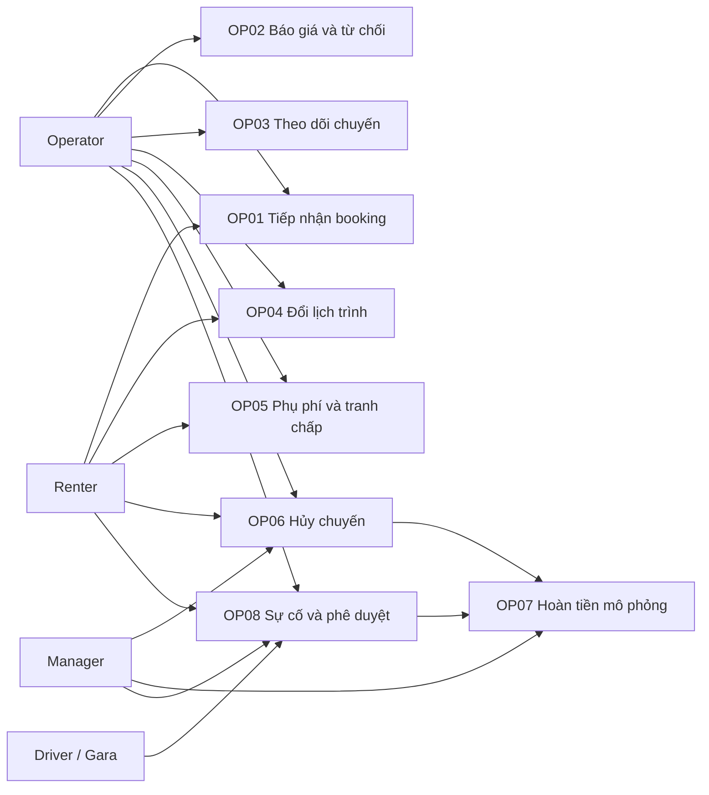
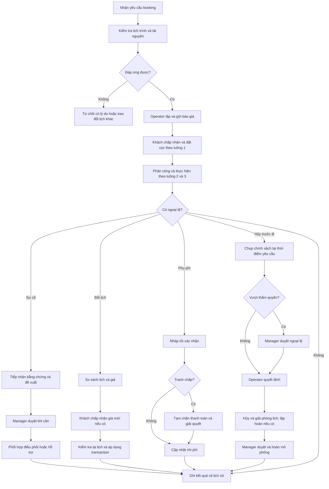
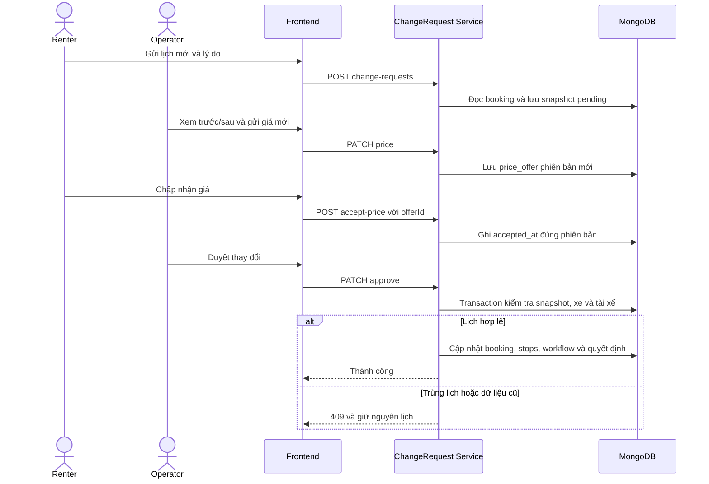
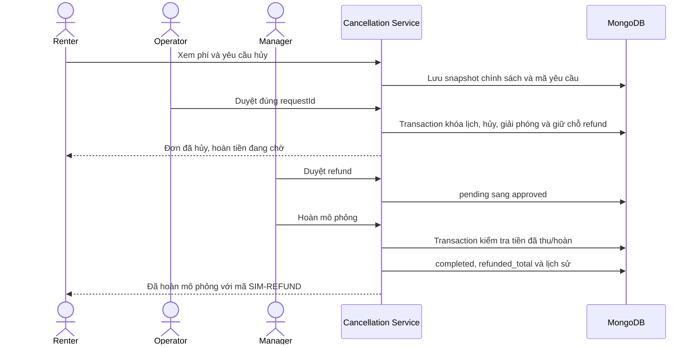
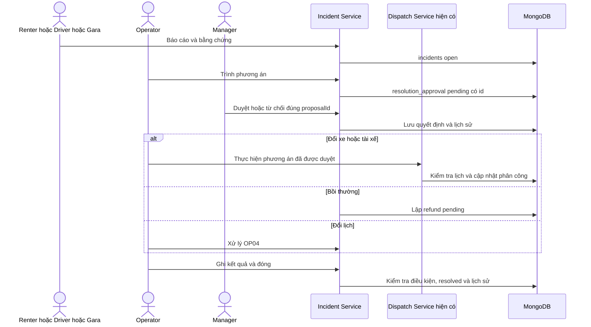

# Đặc tả và sơ đồ workflow người 4

Phạm vi này áp dụng cho VietTour sở hữu xe và cung cấp tài xế. Hoàn tiền là mô phỏng. Quy tắc, API và giới hạn tích hợp chi tiết được mô tả ở WORKFLOW_4.md. Việc ký hợp đồng và quy trình pháp lý không được tự bổ sung trong lần triển khai này.

## Use Case Specifications

| Mã | Use Case | Actor | Tiền điều kiện | Kết quả thành công |
|---|---|---|---|---|
| OP01 | Tiếp nhận và xem xét booking | Operator | Đăng nhập active; có yêu cầu pending | Xem đúng dịch vụ, khách, thời gian, điểm dừng, yêu cầu và khả năng phục vụ |
| OP02 | Gửi báo giá hoặc từ chối | Operator, Renter | Đơn chờ xem xét; không chờ hủy | Báo giá có mã phiên bản hoặc lý do từ chối, Renter theo dõi được |
| OP03 | Theo dõi chuyến | Operator | Có booking được xác nhận/phân công | Xem tiến độ, tài xế, xe và cập nhật gần nhất từ module Driver |
| OP04 | Xử lý thay đổi lịch trình | Renter, Operator | Đơn confirmed trước đi, hoặc in_progress đã được Driver chuyển luồng | Lịch mới và giá được chấp nhận được áp dụng nguyên tử, không trùng lịch |
| OP05 | Ghi nhận và giải quyết phụ phí | Operator, Renter | Đơn confirmed/in_progress/completed | Tổng phí đúng trạng thái, có bằng chứng và lịch sử; tranh chấp được giải quyết |
| OP06 | Hủy chuyến | Renter, Operator, Manager | Chưa khởi hành và chưa bàn giao xe | Hủy sau quyết định, giải phóng lịch và lập hoàn tiền nếu có |
| OP07 | Duyệt và hoàn tiền mô phỏng | Manager | Có giao dịch paid và phiếu hoàn hợp lệ | Ghi nhận hoàn đúng số tiền một lần, có mã mô phỏng và người xử lý |
| OP08 | Tiếp nhận và giải quyết sự cố | Renter, Driver, Gara, Operator, Manager | Có booking/chuyến hợp lệ và quyền báo cáo | Có phương án, phê duyệt khi cần, kết quả và lịch sử; phối hợp module điều phối |

### OP01 Tiếp nhận booking

1. Operator mở danh sách booking, lọc trạng thái, tìm đơn và mở chi tiết.
2. Hệ thống đọc dữ liệu khách, dịch vụ, số người/số chỗ, giờ Việt Nam và các điểm dừng.
3. Operator đối chiếu khả năng phục vụ; hệ thống kiểm tra lịch và tình trạng xe, hồ sơ/lịch tài xế khi gửi giá.
4. Chuyển OP02 hoặc trao đổi với khách về lịch khác.

Ngoại lệ: sai quyền trả 401/403; không có đơn trả 404; thiếu xe/tài xế trả 409, không tự xác nhận đơn.

### OP02 Báo giá và quyết định

1. Operator nhập thông số trong BookingQuoteForm được tái sử dụng.
2. Backend tính lại giá; đơn giá, km/ngày/giờ, phụ phí và lý do điều chỉnh được lưu cùng báo giá.
3. Hệ thống gửi trạng thái quoted để Renter xem, chấp nhận đúng quoteId và mở đặt cọc theo luồng người 1.
4. Nếu không phục vụ được, Operator từ chối với lý do để khách nhìn thấy.

Ngoại lệ: dữ liệu thay đổi hoặc chờ hủy trả 409; số tiền sai trả 400. Không xác nhận dựa trên tổng tiền do client gửi.

### OP03 Theo dõi chuyến

1. Operator mở Trip Monitoring, lọc trạng thái và chọn chuyến.
2. Hệ thống tổng hợp booking, phân công hiện hành, xe, tài xế, điểm dừng và cập nhật gần nhất.
3. Operator làm mới để theo dõi; nếu có đổi lịch/sự cố chuyển OP04/OP08.

Không giả lập GPS hoặc tự thay đổi tiến độ khi chỉ xem màn hình. Tiến độ do người 2 cung cấp.

### OP04 Thay đổi lịch trình

1. Renter mở Chi tiết và yêu cầu, tải lịch đã ghi nhận vào TripForm.
2. Khách chỉnh địa điểm/giờ/điểm dừng và gửi lý do; backend lấy snapshot trước từ database.
3. Hệ thống từ chối yêu cầu trùng đang pending, thời gian sai hoặc thay đổi phần chuyến đã thực hiện.
4. Operator xem bảng so sánh trước/sau; gửi giá mới và lý do nếu có ảnh hưởng giá.
5. Renter chấp nhận đúng mã price_offer; gửi phiên bản mới thì chấp nhận cũ không còn giá trị.
6. Operator duyệt: kiểm tra lại snapshot, khóa lịch xe, lịch tài xế, cập nhật booking/TripStop/TripWorkflow và quyết định trong transaction.
7. Nếu giá mới gây trả thừa, tạo refund pending cho Manager, không tự hoàn tiền.

Ngoại lệ: Operator từ chối có lý do; Renter thấy quyết định. Khi chuyến đang chạy, Driver phải chuyển yêu cầu sang routed_to_booking_changes; không sửa điểm đã hoàn thành. Trùng lịch hoặc dữ liệu cũ trả 409, lịch gốc được giữ.

### OP05 Phụ phí và tranh chấp

1. Operator nhập booking, loại phí, mô tả, số lượng, đơn giá và bằng chứng; tạo draft.
2. Operator có thể sửa nháp hoặc xác nhận kèm lý do. Backend tính amount và cập nhật tổng.
3. Renter xem khoản confirmed và gửi khiếu nại có lý do/bằng chứng.
4. Trong lúc disputed hệ thống tạm dừng thanh toán.
5. Operator xem lịch sử và bằng chứng, chọn giữ khoản phí hoặc miễn; quyết định có lý do.
6. Nếu giảm khoản đã thu, lập hoàn tiền phần trả thừa cho Manager.

Ngoại lệ: không sửa khoản đã xác nhận; không hủy trực tiếp khoản đang tranh chấp; sai quyền, số tiền sai, quyết định lặp đều bị chặn.

### OP06 Hủy chuyến

1. Renter/Operator xem phí dự kiến theo chính sách active và thời điểm yêu cầu.
2. Gửi yêu cầu cùng lý do; lưu mã yêu cầu và snapshot chính sách.
3. Operator xem xét, từ chối hoặc duyệt đúng mã yêu cầu.
4. Nếu phí vượt tiền đã thu, Manager xét ngoại lệ và nhập phí giữ lại cùng lý do.
5. Transaction hủy booking, checkout, các yêu cầu đổi lịch pending và phân công; đồng thời tạo phiếu hoàn tiền theo từng payment.
6. Các bên xem trạng thái và lịch sử trong ứng dụng.

Ngoại lệ: thiếu chính sách, tiền đã thu không khớp ledger, xe đã bàn giao hoặc đã khởi hành thì không hủy qua luồng thông thường. Không tính phần tiền chưa thu là đã hoàn. Không đổi xe maintenance thành available.

### OP07 Hoàn tiền

1. Manager mở hàng đợi refunds, xem booking, payment, số tiền, nguồn và lý do.
2. Manager duyệt hoặc từ chối kèm lý do.
3. Với phiếu approved, Manager chọn hoàn mô phỏng và ghi chú.
4. Backend kiểm tra số đã hoàn của payment, trạng thái phiếu, phương thức simulation/promotion và cập nhật hoàn trong transaction.
5. Renter/Operator xem completed, số tiền và mã SIM-REFUND.

Ngoại lệ: hoàn vượt số đã thu, hoàn lặp, sai trạng thái hoặc giao dịch tiền thật đều bị từ chối. Phiếu không hoàn thành thì không tăng refunded_total.

### OP08 Sự cố và Manager Approval

1. Renter/Operator báo mô tả, loại, URL bằng chứng; Driver và Gara dùng API báo cáo đang có.
2. Operator xem sự cố và hồ sơ Gara; ghi phương án hỗ trợ, bồi thường, đổi xe/tài xế hoặc đổi lịch.
3. Trường hợp đặc biệt (tai nạn/khiếu nại), bồi thường hoặc vượt thẩm quyền được trình Manager bằng đề xuất có phiên bản.
4. Manager duyệt/từ chối; từ chối cho phép Operator đề xuất lại.
5. Phương án đổi xe dùng API dispatch và quy trình bàn giao của Gara. Đổi tài xế sử dụng lại kiểm tra availability, tạo phân công mới; Driver mới phải nhận chuyến. Đổi lịch chuyển tới OP04. Bồi thường tạo OP07.
6. Operator ghi kết quả, đóng sự cố khi các điều kiện phối hợp đã hoàn tất; nếu còn sự cố khác thì không khôi phục sớm chuyến.

Ngoại lệ: không có workflow để đổi xe/tài xế thì không duyệt phương án điều phối, cần chọn hỗ trợ khách; chờ duyệt/từ chối thì không đóng qua API cũ. Bằng chứng ngoài HTTPS hoặc quá giới hạn bị chặn. Phê duyệt không thay cho việc thực hiện đổi xe/tài xế.

## Sơ đồ Use Case

## Activity Diagram

## Sequence Diagram đổi lịch

## Sequence Diagram hủy và hoàn

## Sequence Diagram sự cố

